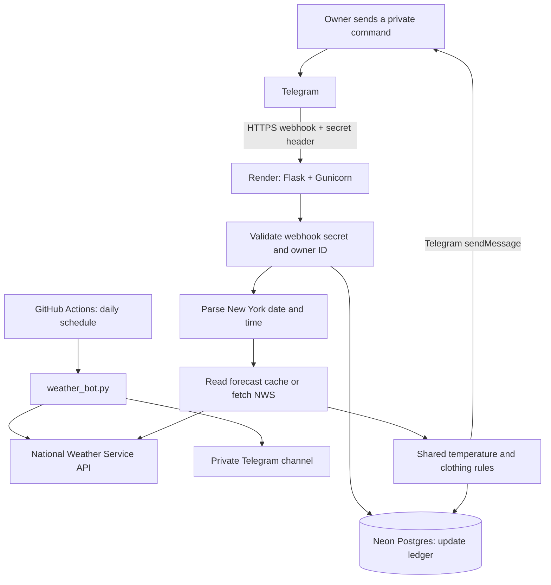

# Morning Weather Bot

A personal Telegram weather assistant for **Kent, Ohio 44240**. It sends a daily morning briefing and answers private commands with forecasts and practical clothing advice—all using public National Weather Service data, without a paid weather or AI API.

[](https://github.com/ShahbazShaikh96/Morning-Weather-Bot/actions/workflows/web-tests.yml)
[](https://github.com/ShahbazShaikh96/Morning-Weather-Bot/actions/workflows/weather.yml)

**Built with:** Python · Flask · Gunicorn · Telegram Bot API · NWS API · GitHub Actions · Render · Neon Postgres

## Why I built it

Checking a weather app still leaves a practical question: **what should I wear when I leave?** I built this project to turn hourly forecasts into a short, useful briefing—temperature, precipitation, wind, and clothing suggestions—in Telegram, where I can read it quickly.

It started as a scheduled Python script. I then extended it into an interactive web application while keeping the original daily briefing independent.

## What it does

- Posts a morning briefing to a private Telegram channel, scheduled for **8 a.m. America/New_York**.
- Answers owner-only private commands for specific dates, times, and parts of the day.
- Shows temperatures in **Fahrenheit and Celsius**, precipitation chances, and available wind information.
- Recommends layers, umbrellas, water-resistant shoes, and windbreakers using transparent rules.
- Accepts inputs such as `Monday morning`, `11th October`, and `October 11 at 3pm`.
- Formats private replies with bold headings, measurement labels, and clear spacing.
- Reports missing or out-of-range forecast data honestly.

The deployed bot is [@kent_weather_bot](https://t.me/kent_weather_bot). **It is a personal bot, not a public demo:** private commands are restricted to the configured owner's Telegram user ID. Other users can deploy their own copy.

## Example commands

Send **one command per message** in a private chat with your bot:

```text
/help
/forecast tomorrow 15:00
/forecast Monday morning
/forecast 11th October
/forecast October 11 at 3pm
/forecast 2026-10-12 09:00
/clothes tomorrow evening
/clothes Monday morning
```

Both `/forecast` and `/clothes` accept the supported date/time expressions. `/start` also displays help. This is a deterministic command parser, not an open-ended AI chatbot.

| Input | Interpretation |
|---|---|
| `today` / `tomorrow` | Relative to the current New York date |
| `Monday` | Next Monday with a future requested start time; can mean today |
| `11th October` / `October 11` | Next occurrence of that date; noon if time omitted |
| `11 October 2026` / `2026-10-11` | Explicit date |
| `15:00` / `3pm` / `3:30pm` | Specific local time |
| `morning` | 08:00–12:00 |
| `afternoon` | 12:00–18:00 |
| `evening` | 18:00–22:00 |
| `night` | 22:00–00:00 |

All command times use **America/New_York**. Past times are rejected, as are nonexistent or ambiguous times around daylight-saving changes. A time block requires complete hourly forecast coverage. Accepting a date does not mean NWS has a forecast for it.

### Example private reply

Illustrative values, not a live forecast:

> **Kent, Ohio 44240**<br>
> **Mon, 12 Oct 2026**<br>
> **08:00–12:00 EDT**
>
> Partly Cloudy
>
> **Temperature:** 50°F / 10°C to 61°F / 16°C<br>
> **Precipitation:** up to 20%<br>
> **Wind:** W 5 mph
>
> **WHAT TO WEAR**<br>
> Light jacket or hoodie, long pants, sneakers.
>
> NWS · hourly data cached up to 5 minutes

## How it works



**Daily delivery:** GitHub Actions runs `weather_bot.py`, fetches NWS daily/hourly forecasts and alerts, builds a briefing, and sends it to the configured channel. Render is not involved.

**Interactive delivery:** Telegram posts each incoming message to `/telegram/webhook`. The Flask app verifies the secret header and private-chat sender, parses the command, gets the relevant hourly forecast, records a durable send claim, and replies using Telegram's `sendMessage` API.

**Shared logic:** Both paths reuse the temperature conversion, precipitation extraction, and clothing rules in `weather_bot.py`. Clothing advice is rule-based: for example, temperatures below 10°C suggest a jacket; precipitation chances of at least 40% add umbrella advice.

## How I built it

1. **Started with a small scheduled script.** Used the NWS `/points` endpoint to discover forecasts for Kent, then converted those forecasts into a Telegram briefing with configurable clothing rules.
2. **Automated daily delivery.** Added GitHub Actions, repository secrets, a dry-run mode, and a separate Telegram connection test.
3. **Added an interactive web service.** Built a Flask webhook, served it with Gunicorn on Render Free, and kept daily delivery separate.
4. **Added access controls and durable duplicate tracking.** Validated Telegram's secret header and my personal user ID; stored update IDs in Neon because Render's free filesystem is ephemeral.
5. **Tested failure cases.** Covered missing forecasts, daylight-saving transitions, retries, concurrent update claims, restart persistence, and ambiguous sends.
6. **Improved speed and usability.** Cached NWS responses, added natural date expressions, and replaced dense output with bold, readable replies.

Real deployment issues also shaped the implementation: configuration errors now name the invalid variable without printing its value, and Postgres query timeouts are set inside transactions because Neon's pooler rejects that option during connection startup.

## Reliability decisions

### Retried updates should not produce repeated replies

Telegram can deliver an update more than once. The app stores its `update_id` in Postgres with a unique primary key, so concurrent requests and app restarts cannot normally send the same update again. Sending a new command creates a new update ID and gets a new reply.

Failures before a durable send claim return HTTP 503 for Telegram to retry. An explicit Telegram rate-limit response releases the claim for a later retry.

**Exactly-once delivery is not guaranteed.** A connection can drop after Telegram accepts a message but before the app receives confirmation. The app retains the claim instead of risking a duplicate send. A crash after claiming but before sending can also leave a reply missing. In either case, the owner can send a new command. The ledger protects private webhook replies; it does not deduplicate daily GitHub briefings.

### Faster repeated commands without inventing fresh data

- NWS point metadata: cached for **24 hours**.
- Hourly forecast data: cached for **5 minutes**.
- Concurrent cache misses share one refresh.
- Expired data is not served as a fallback during an outage.
- The cache is disposable; the update ledger remains durable in Neon.

### Free hosting has practical limits

Render Free sleeps after 15 minutes without inbound traffic. Waking it takes about a minute, and Telegram retries can add delay. Warm replies still depend on NWS, Neon, and Telegram; there is no guaranteed response time. No keep-alive scheduler is included.

GitHub Actions schedules are also best-effort and can be delayed or dropped. Telegram retains incoming updates for at most 24 hours. This is a personal project, not a guaranteed weather-alert service.

See [Render's free-service limits](https://render.com/docs/free), [GitHub's schedule behavior](https://docs.github.com/en/actions/reference/workflows-and-actions/events-that-trigger-workflows#schedule), and [Telegram's update delivery documentation](https://core.telegram.org/bots/api#getting-updates).

## Run your own copy

### Local setup

Use **Python 3.12**:

```bash
git clone https://github.com/ShahbazShaikh96/Morning-Weather-Bot.git
cd Morning-Weather-Bot
python3 -m venv .venv
source .venv/bin/activate
python -m pip install -r requirements.txt
python -m unittest discover -v
```

Preview a daily briefing without sending a Telegram message:

```bash
python weather_bot.py --dry-run
```

### Deployment configuration

Create your own Telegram bot through BotFather, a **Free Neon Postgres project**, and a **Free Render web service** using `render.yaml`.

| Variable | Where used | Purpose |
|---|---|---|
| `TELEGRAM_BOT_TOKEN` | Render and GitHub Actions secrets | Your bot's BotFather token |
| `TELEGRAM_CHAT_ID` | GitHub Actions secrets | Destination channel ID for the daily briefing |
| `TELEGRAM_ALLOWED_USER_ID` | Render | Positive numeric ID of the owner; not the bot ID or channel ID |
| `TELEGRAM_WEBHOOK_SECRET` | Render and webhook registration | Matching random 32–256 character secret using letters, numbers, `_`, or `-` |
| `DATABASE_URL` | Render | Neon pooled Postgres connection string with TLS enabled |
| `NWS_USER_AGENT` | Both paths | Identifies your application to NWS |

The default location is Kent. `WEATHER_LAT`, `WEATHER_LON`, and `WEATHER_LOCATION` can configure another location. Private command parsing remains fixed to America/New_York; changing a location does not automatically change that timezone.

Enter secrets directly in the appropriate dashboards or hidden local prompts. **Never commit credentials.** GitHub secrets cannot be read back to populate Render. The setup scripts do not load a `.env` file automatically.

Once Render is live, register Telegram's webhook locally:

```bash
python manage_webhook.py register
```

The script prompts for the token, public Render URL, and webhook secret. Token and secret input are hidden. Check registration with:

```bash
python manage_webhook.py status
```

Send `/help` privately to your own bot to test delivery. For complete account setup, identity discovery, health checks, and live acceptance steps, see [DEPLOYMENT.md](DEPLOYMENT.md). The `/healthz` endpoint checks database availability; it does not confirm Telegram registration or end-to-end delivery.

## Tests and repository layout

CI runs the test suite against disposable Postgres, including concurrent claims and persistence across connection/app recreation. The local HTTP end-to-end test exercises the webhook and command path with NWS and Telegram fixtures; it is not a live external-service test. The real Postgres test skips locally unless `TEST_DATABASE_URL` points to a disposable test database.

| File | Responsibility |
|---|---|
| `weather_bot.py` | Daily briefing, NWS requests, shared clothing and temperature rules |
| `commands.py` | Natural date parsing and private reply content |
| `web_app.py` | Webhook authentication, owner restriction, Telegram HTML formatting and delivery |
| `storage.py` | Durable Postgres update ledger |
| `forecast_cache.py` | Thread-safe, time-limited NWS cache |
| `manage_webhook.py` | Hidden-prompt identity discovery, registration, and status |
| `telegram_setup.py` | Original channel-ID discovery tool; use before webhook registration |
| `test_*.py` | Weather, command, cache, webhook, formatting, and integration tests |
| `render.yaml` | Free Render service configuration |
| `.github/workflows/` | Daily briefing and automated tests |

## Weather-data limits

The selected NWS hourly feed provides temperatures, precipitation chances, and wind speed/direction when available. **Gusts and feels-like values are not fetched by this app.** NWS offers gust forecasts in separate grid data; adding them would require another request and matching its time intervals and units. Missing precipitation data does not mean a 0% chance of rain.

Weather source: [National Weather Service API](https://www.weather.gov/documentation/services-web-api). For current warnings, consult [weather.gov](https://www.weather.gov/).
